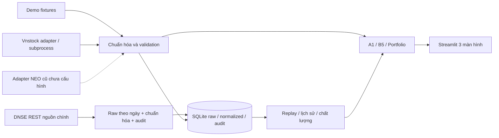

# NEO LiquidityLab

Các đoạn về task toàn thị trường, server và mẫu 66 snapshot dưới đây mô tả **nguồn Vnstock cũ**. Dữ liệu/luồng DNSE hiện tại được mô tả ở đầu trang và trong hướng dẫn DNSE.

Hệ thống mô phỏng chi phí thực hiện lệnh và stress thanh khoản danh mục cổ phiếu Việt Nam, phục vụ đồ án UEL 2026–2027. Nhà đầu tư có thể xem quy mô lệnh so với ba mức chào mua/bán và số tiền ước tính **chỉ trên phần được bao phủ**. Dành cho người có vị thế tương đối lớn so với độ sâu quan sát.

MVP gồm A1, B5, danh mục nhập tay, SQLite, collector và Replay. **DNSE OpenAPI là nguồn chính theo quyết định ngày 03/11/2026; không tiếp tục tích hợp NEO VPBankS.** Vnstock là nguồn cũ, Demo là synthetic. Không có chức năng đặt/sửa/hủy lệnh thật.

**Luồng WS mới (04/11):** sau mỗi checkpoint GitHub, dữ liệu được chuẩn hóa, audit và lưu checkpoint mã hóa riêng `dnse-ws-normalized`. Giữ số nguồn, timestamp nanosecond, tất cả mức giá, receipts/gaps và quarantine. **ACB/G1/HOSE đã đối chiếu WS–REST 88/88 thông điệp tại 83 thời điểm nguồn: giá ×1.000, khối lượng ×10.** Với ACB, thông điệp đủ ba mức mỗi bên có thêm `canonical_snapshot` VND/CP dùng cho A1/B5; không ghép mức thiếu. Các mã khác vẫn chưa xác minh độc lập; chưa khẳng định semantics toàn bộ 10 mức. Xem [quy trình, bằng chứng và lệnh khôi phục/xuất tệp riêng](docs/dnse_ws_normalization.md).

[Quyết định nguồn](docs/data_source_decision.md) ghi nhận người thực hiện đã xác nhận việc dùng DNSE được thống nhất ngày 03/11/2026. Dashboard dùng giao diện đen–xám theo Penpot, mặc định nguồn DNSE; tên repo và adapter NEO cũ còn được giữ.

## Dashboard web và Streamlit

Bản web chính trên GitHub Pages: https://tranthanhphu39.github.io/neo-liquiditylab/ — truy cập công khai, không cần đăng nhập ChatGPT. Bản Sites riêng tư trước đó vẫn được giữ.

Bản web gồm **Thanh khoản, Mô phỏng lệnh A1 và Stress danh mục B5**, dùng cùng lõi Python/Decimal với Streamlit. Khi mở trang, dashboard **tự tải ngày DNSE mới nhất đã công bố**, không cần chọn tệp. Dữ liệu công khai là lịch sử đã chuẩn hóa/audit, có lấy mẫu; dữ liệu mẫu giả lập vẫn có nhãn riêng. Không đưa khóa API vào trình duyệt.

Lần xuất hiện tại gồm 7 ngày đến 05/11/2026, 119 phần dữ liệu nén tổng khoảng 17,9 MB. Mỗi ngày có mốc 11:29, 14:20, 15:10 toàn thị trường và lịch sử từng mã lấy snapshot cuối mỗi khoảng 6 phút. Trình duyệt chỉ tải thêm lịch sử của mã/danh mục đang chọn, kiểm tra checksum và giữ nguyên nhãn thiếu dữ liệu, chưa xác minh đơn vị. Đây không phải toàn bộ tick trong phiên hoặc dữ liệu realtime.

Cập nhật dữ liệu web từ kho REST **đã chuẩn hóa và audit** trên máy:

```powershell
.\.venv\Scripts\python.exe -m scripts.export_web_data --publish
```

Hoặc tải ngày mới, audit, chuẩn hóa rồi tự xuất và đẩy dữ liệu gọn lên dashboard trong cùng lệnh (sau 15:10 giờ Việt Nam):

```powershell
.\.venv\Scripts\python.exe -m scripts.update_dnse_day --publish-web
```

Các lệnh có `--publish`/`--publish-web` công khai phần dữ liệu chuẩn hóa gọn trong `web/data/`; raw, database đầy đủ và thông tin tài khoản không được đưa lên Pages. Các ngày cũ không đổi được tái sử dụng. Bản web tự chọn ngày mới nhất sau lần cập nhật thành công. **Bước thu REST và chuẩn hóa vẫn chạy trên máy; checkpoint WebSocket của Actions chưa tự trở thành dữ liệu chuẩn hóa cho dashboard.**

Xuất tệp để mở trên web, từ kho đã tải và chuẩn hóa trên máy:

```powershell
# Toàn bộ mã có snapshot trước 14:20 của ngày mới nhất
.\.venv\Scripts\python.exe -m scripts.export_dashboard
# Thêm lịch sử ACB, tối đa 300 điểm mẫu
.\.venv\Scripts\python.exe -m scripts.export_dashboard --date 2026-11-03 --symbols ACB --samples 300
```

Tệp nằm ở `data/exports/dashboard/dnse_YYYY-MM-DD.json`. **Mở tệp riêng** là tùy chọn bổ sung, không cần dùng để mở dashboard. Có thể dùng `--at 15:10` để xem cuối ngày; mô phỏng vẫn khóa snapshot ngoài phiên liên tục. Tệp riêng không upload lên máy chủ và không còn trong bộ nhớ khi tải lại tab; trang trở lại dữ liệu web tự tải. Mã không có snapshot không được tự gán 0. Tối đa 25 MB / 30.000 snapshot mỗi tệp; nếu nhiều mẫu, hãy giới hạn `--symbols`.

Streamlit tiếp tục đọc trực tiếp SQLite trên máy:

```powershell
.\.venv\Scripts\python.exe -m streamlit run src/app/main.py
```

Thiết kế gốc nằm trong Penpot; mã web công khai ở [`web/`](web/README.md). Workflow [`dashboard-pages.yml`](.github/workflows/dashboard-pages.yml) tự đóng gói lõi Python và deploy khi mã web thay đổi trên `main`; không sử dụng secret DNSE. Mã chưa xác minh đơn vị vẫn có thể xem chỉ số quan sát, nhưng bị loại khỏi A1/B5. Chọn Replay và thời điểm phiên liên tục để phân tích dữ liệu lịch sử.

**Chốt dữ liệu đến 03/11/2026:** năm ngày giao dịch 28, 29, 30/10 và 02, 03/11, **4.570.076 snapshot duy nhất**. Audit 5.195.736 lượt raw từ sáu kho đạt, 0 cách ly, integrity ok, 0 lỗi FK. Riêng 03/11: 1.517 mã trong danh mục, 827.811 bản ghi raw, 823.094 snapshot duy nhất. Hồi quy gần nhất **214 tests đạt**; AppTest dữ liệu 02/11 đạt ba màn hình. Báo cáo ngày nằm cục bộ ở `report/dnse_day_completion_2026-11-03.md/.json`. Xem thêm [đối chiếu đề](docs/assignment_compliance.md), [giới hạn](docs/limitations.md).

## Quy trình vận hành hằng ngày

**Tự công bố trên máy đã bật theo yêu cầu ngày 05/11:** lệnh `scripts.update_dnse_day` cho cả ngày tự xuất dữ liệu lấy mẫu và đẩy lên Pages sau khi toàn bộ audit/kiểm tra tài chính đạt. Chính sách nằm ở `config/web_publication.json`; thêm `--no-publish-web` nếu muốn một lượt chỉ lưu trên máy. Nhánh GitHub chuẩn hóa → audit → công bố đã viết và kiểm thử offline, giữ `github_enabled=false` đến khi người dùng duyệt bootstrap bằng chứng riêng. REST trên runner hiện vẫn timeout. Xem [hướng dẫn tự cập nhật web](docs/automatic_web_publication.md).

Các lệnh dưới đây chạy trong **PowerShell tại thư mục chứa README**, trên workspace đã có `.venv`, `.env` và hồ sơ đối chiếu đơn vị DNSE cục bộ. Clone repo public không tự tải dữ liệu, hồ sơ bằng chứng riêng hoặc khóa giải mã về máy. Trong `.env` cần có `DNSE_API_KEY` và `DNSE_API_SECRET`; không in giá trị hoặc đưa vào câu lệnh.

### 1. Phân biệt việc GitHub tự làm và việc cần chạy trên máy

| Công việc | Hiện chạy ở đâu? | Có cần mở máy cá nhân? |
| --- | --- | --- |
| Nhận raw WebSocket G1 trong phiên | GitHub Actions, đã bật lịch | Không |
| Lưu checkpoint raw WebSocket mã hóa | GitHub Releases, mỗi 15 phút và khi dừng bình thường | Không |
| Tự tải checkpoint WebSocket về máy | Chưa có CLI đồng bộ hằng ngày | Chưa tự động |
| Chuẩn hóa cấu trúc WebSocket | Tự chạy sau mỗi checkpoint GitHub, lưu mã hóa riêng; đơn vị WS còn chưa xác minh | Không cần mở máy để chuẩn hóa cấu trúc; chưa dùng A1/B5 |
| Khôi phục bản cấu trúc WS về máy | `scripts.sync_dnse_ws_normalized --date YYYY-MM-DD --partition morning` hoặc `afternoon` | Có, khi cần xem trên máy |
| Tải lịch sử REST và chuẩn hóa cho dashboard | Lệnh `scripts.update_dnse_day` trên máy | Có, trong khi lệnh chạy |
| Tải bù raw REST khi runner bỏ lỡ cửa sổ realtime | Actions tự thử sau khi phiên đóng; lưu checkpoint mã hóa `dnse-rest-history`. Nếu REST không kết nối được hoặc tải chưa đủ, job báo lỗi | Không; chưa bảo đảm kết nối REST từ runner |
| Khôi phục raw REST tải bù để chuẩn hóa trên máy | `scripts.sync_dnse_rest_history --date YYYY-MM-DD --session day`, rồi `scripts.update_dnse_day --date YYYY-MM-DD` | Có |
| Làm mới danh mục dùng cho GitHub | Lệnh `scripts.prepare_dnse_realtime --publish` trên máy | Có, trong lúc cập nhật |

**Lệnh chuẩn hóa hiện tại chỉ đọc lịch sử REST trong `data/history/dnse`, không đọc checkpoint WebSocket trên Releases.** GitHub đã thu raw không có nghĩa dashboard trên máy tự có ngày mới. Nếu chỉ cần tích lũy raw WS, không phải mở máy mỗi ngày. Nếu muốn cập nhật kho phân tích hiện có, dùng bước 3 sau phiên; bước này tải REST riêng, không nhập dữ liệu từ GitHub.

### 2. Hằng ngày: kiểm tra hai lượt thu tự động trên GitHub

Mở [Actions → DNSE realtime G1 collector](https://github.com/TranThanhPhu39/neo-liquiditylab/actions/workflows/dnse-realtime.yml).

| Lượt thu | Giờ cron dự kiến, giờ Việt Nam | Cửa sổ quan sát của collector |
| --- | --- | --- |
| Sáng | 08:52, thứ Hai–thứ Sáu | 08:57–11:31 |
| Chiều | 12:52, thứ Hai–thứ Sáu | 12:57–15:06 |

Lịch đã bật ngày 03/11, lượt định kỳ đầu dự kiến 04/11. GitHub có thể khởi chạy trễ; chưa tích hợp lịch nghỉ lễ. WebSocket cần kết nối trong phiên, không tải lại diễn biến đã qua bằng cách chạy cuối phiên. Hai lượt thử ngoài giờ đã xác minh kết nối/lưu/khôi phục trên hai runner mới; tải thực cả phiên và lần cron đầu vẫn cần kiểm chứng.

Sau khi job kết thúc, xem summary và log bước **Restore collect normalize audit and save encrypted checkpoints**:

- Trạng thái kết thúc bình thường của lượt thu là `WINDOW_ENDED_OBSERVED_ONLY`.
- Kiểm tra `shards_subscribed` bằng `expected_connections`, `fatal_error` là `null`, `unpersisted_receipts_this_run` bằng 0, `audit.state` là `VERIFIED`, checkpoint đã lưu.
- Xem thêm `receipt_count`, `symbols_observed`, `known_gaps`. Job xanh hoặc subscribe đủ chưa chứng minh dữ liệu đủ cả phiên; mã không có thông điệp chưa được coi là khối lượng 0. `SKIPPED_OUTSIDE_COLLECTION_WINDOW` nghĩa là đã bỏ qua lượt thu.

**Phục hồi khi chạy trễ (bản sửa 05/11):** lịch sáng đến sau 11:31 tự thử REST phiên sáng; lịch chiều đến sau 15:06 đợi tới 15:10 rồi thử REST cả ngày. Lượt đến giữa phiên vẫn nhận WS phần còn lại rồi tải bù REST khi đóng phiên. Cron sáng luôn giữ phiên sáng dù GitHub giao vào buổi chiều. Không đổi các mốc cron; bản sửa không khắc phục việc GitHub chưa phát sự kiện lịch.

- `RECOVERED_REST_HISTORY_REALTIME_MISSED`: lịch sử REST đã tải hết trang, audit đạt và lưu mã hóa; vẫn đánh dấu phần realtime bị lỡ. Không khôi phục được receipts WS đã mất.
- `FAILED_REST_BACKFILL`: kết nối, tải, audit hoặc lưu checkpoint chưa thành công; job đỏ. Khi có DB, phần đã tải cũng được thử lưu mã hóa để chạy tiếp. Trường `checkpoint` cho biết đã lưu được hay chưa.
- Trạng thái bỏ qua, dừng, tạm dừng và trạng thái lạ không còn tự trả mã thành công. Summary vẫn được ghi khi bước thu lỗi.

Tải bù trên Actions có giới hạn 6.000 request quote/lượt, tối đa 90 phút cho vòng tải (cộng thời gian request đang thực hiện, audit và lưu checkpoint). Checkpoint tiến độ khoảng 5 phút khi vòng tải đang chạy, và khi kết thúc. Mỗi lần thử vẫn theo rate limit hiện có; lỗi kết nối REST từ GitHub trước đây chưa được xem là đã giải quyết.

Muốn chạy tiếp một bản tải bù trên GitHub: **Run workflow → mode `backfill` → backfill_session `morning` hoặc `day` → rest_max_requests `6000`**. Chế độ này lấy ngày hiện tại theo Việt Nam và chỉ cho phiên đã đóng. Chọn `1` để kiểm tra ngắn (ngoài các request danh mục và retry hữu hạn); tải một phần sẽ báo lỗi, không coi là đã xong.

Để lấy checkpoint REST về kho trên máy, ví dụ sau khi phiên đã đóng:

```powershell
.\.venv\Scripts\python.exe -m scripts.sync_dnse_rest_history --date 2026-11-05 --session day
.\.venv\Scripts\python.exe -m scripts.update_dnse_day --date 2026-11-05
```

Lệnh đồng bộ cần quyền đọc Releases và khóa giải mã đang lưu cục bộ; từ chối ghi đè `history.db`/`universe.json` đã có. Nếu đã có kho ngày đó trên máy, dùng `update_dnse_day` để tiếp tục kho hiện tại. Checkpoint chỉ chứa raw REST và báo cáo mã hóa; cần bước cập nhật trên máy để chuẩn hóa/audit, dashboard và Pages chưa tự nhận ngày mới từ checkpoint này. Xem [chi tiết phục hồi](docs/dnse_rest_recovery.md).

Có thể tải báo cáo log đã lọc về máy bằng lệnh dưới đây. Run ID là số cuối URL dạng `/actions/runs/41629043291`:

```powershell
$runId = Read-Host 'Nhap Run ID can kiem tra'
.\.venv\Scripts\python.exe -m scripts.github_monitor $runId
```

Lệnh cần quyền đọc repo qua GitHub token đã cấu hình hoặc Git Credential Manager đã đăng nhập trên máy. Báo cáo nằm ở `report/github/run_<RUN_ID>.json`; đây là báo cáo vận hành, không phải lệnh tải raw WebSocket.

### 3. Sau phiên: cập nhật dữ liệu chuẩn hóa cho dashboard trên máy

**Cách thường dùng: sau 15:10 giờ Việt Nam của ngày giao dịch, chạy một lệnh:**

```powershell
# Tải lịch sử và cập nhật cho hôm nay, theo múi giờ Việt Nam.
.\.venv\Scripts\python.exe -m scripts.update_dnse_day
```

Muốn tải bù ngày cụ thể, thay ngày trong ví dụ:

```powershell
.\.venv\Scripts\python.exe -m scripts.update_dnse_day --date 2026-11-03
```

Chuỗi này tự làm: lấy danh mục REST → tải hết trang → audit raw → báo cáo mã trả rỗng/thiếu/lỗi → chuẩn hóa → đối chiếu raw–snapshot → xuất JSONL, checksum và manifest → kiểm tra tài chính. **Không cần chạy thêm lệnh chuẩn hóa sau khi chuỗi đã `COMPLETED`.** Giữ máy bật và có mạng trong lúc tải; chuẩn hóa/audit/xuất kho nhiều ngày có thể mất thêm thời gian sau khi tải đã xong.

Nếu cần phân tích riêng phiên sáng, chạy sau 11:30; buổi chiều vẫn dùng lệnh cả ngày ở trên:

```powershell
.\.venv\Scripts\python.exe -m scripts.update_dnse_day --session morning
```

Kho sáng nằm riêng trong `data/history/dnse/YYYY-MM-DD/morning`; bản cả ngày giữ cả hai phiên. Bản trùng giữa các kho được giữ lineage, không cộng thành snapshot duy nhất mới.

Nếu chỉ muốn bỏ bước xuất JSONL lớn, giữ nguyên thu/chuẩn hóa/audit và cập nhật dashboard SQLite:

```powershell
.\.venv\Scripts\python.exe -m scripts.update_dnse_day --no-export
```

Khi dùng `--no-export`, tệp JSONL cũ nếu còn không phải bản xuất của kho mới; xem `exports_refreshed` trong manifest.

**Nếu raw REST đã có và chỉ muốn chạy riêng chuẩn hóa/kiểm tra**, dùng:

```powershell
.\.venv\Scripts\python.exe -m scripts.normalize_dnse_history
.\.venv\Scripts\python.exe -m scripts.audit_dnse_normalized --export
```

Hai lệnh này làm việc trên các kho REST hoàn tất đã lưu; không gọi thu WebSocket, không tự tải ngày còn thiếu và không chạy đủ chuỗi cập nhật manifest/kiểm tra tài chính của `update_dnse_day`. Trong vận hành hằng ngày nên dùng lệnh một bước ở đầu mục này.

Kiểm tra kết quả của ngày đã chọn, ví dụ 03/11:

```powershell
Get-Content .\report\dnse_update_2026-11-03_day.json -Encoding UTF8
Get-Content .\data\processed\dnse\manifest.json -Encoding UTF8
```

Chỉ chốt khi report cập nhật có `state=COMPLETED`, audit chuẩn hóa có `state=VERIFIED`, manifest có `state=NORMALIZED_AND_AUDITED`, kiểm tra tài chính `PASSED`. Báo cáo raw phải hết phân trang; API trả rỗng được ghi riêng, không tự đổi thành sổ lệnh 0. Bộ lệnh không tự viết bản tóm tắt `dnse_day_completion_*.md`; báo cáo tự sinh là `dnse_update_*`, `dnse_history_*`, `dnse_missing_*` và các audit/manifest.

Mở dashboard sau khi cập nhật:

```powershell
.\.venv\Scripts\python.exe -m streamlit run src/app/main.py --server.address 127.0.0.1
```

Chọn nguồn **dnse**, ngày cần xem và mã. REST ACB giữ phạm vi xác minh thực nghiệm; các mã khác còn nhãn `ASSUMED_SHARED_SCHEMA`. Chưa áp hệ số REST sang WebSocket hoặc tự mở A1/B5 cho dữ liệu chưa xác minh.

### 4. Mỗi tuần: làm mới danh mục cho lịch GitHub trước khi quá 7 ngày

Giới hạn **7 ngày lịch** là quy tắc của code cho **danh sách mã cần theo dõi**; không phải hạn API key, hạn lưu dữ liệu hoặc số phiên thu. Nên cập nhật mỗi tuần, chẳng hạn thứ Sáu sau phiên và khi job thu đã kết thúc. Được cập nhật sớm, không cần đợi hết hạn.

Seed ngày 03/11 hiện được chấp nhận đến hết **10/11**. Nếu chưa cập nhật thì từ **11/11** collector báo danh mục quá hạn và không thu tiếp; dữ liệu cũ vẫn giữ nguyên.

Trên máy gốc đã có khóa giải mã checkpoint và quyền GitHub, chạy:

```powershell
$env:DNSE_REALTIME_STORAGE_APPROVED = 'true'
.\.venv\Scripts\python.exe -m scripts.prepare_dnse_realtime --publish
if ($LASTEXITCODE -ne 0) { throw 'Cap nhat danh muc that bai; xem error_code truoc khi tiep tuc.' }
Get-Content .\report\dnse_ws_catalog_preparation.json -Encoding UTF8
```

Kết quả cần có `state=CATALOG_PREPARED_AND_ENCRYPTED`, ngày `as_of_date` mới và `encrypted_release` khác `null`. Lệnh lấy lại danh mục từ DNSE trên máy, cập nhật `data/control/dnse_ws_catalog.json`, rồi đưa seed **mã hóa** lên Releases. Các job GitHub kế tiếp đọc seed mới. Không phải tải lại dữ liệu ngày cũ hay bật lại lịch sau mỗi lần cập nhật.

Chỉ chạy `scripts.prepare_dnse_realtime` **không có `--publish`** thì mới cập nhật trên máy, GitHub vẫn dùng seed cũ. Số mã có thể thay đổi; ví dụ seed thử trước có 1.518 mã, danh mục tải lịch sử tối 03/11 có 1.517. Ngày hết hạn của GitHub tính từ seed đã publish thành công, không từ ngày chạy tải lịch sử REST.

Giữ đúng khóa `LIQUIDITYLAB_STATE_KEY` đã dùng. Máy gốc có bản sao mã hóa Windows tại `data/control/github_state_key.dpapi`; thuộc tài khoản Windows đó. Nếu gặp `STATE_KEY_BACKUP_MISSING_DO_NOT_REGENERATE`, cần khôi phục đúng khóa hiện có, không tự tạo khóa khác hoặc chạy lệnh ghi đè secret để xử lý.

### 5. Khi lượt thu/tải lỗi hoặc cần tạm dừng

| Tình huống | Cách xử lý |
| --- | --- |
| REST đang tải thì mất mạng hoặc bị ngắt | Đọc `error_code`, xử lý nguyên nhân rồi chạy lại đúng `update_dnse_day --date ...` và cùng `--session`; bộ tải tiếp tục từ checkpoint. Không xóa kho raw để bắt đầu lại. |
| Có tệp `data/control/STOP_DNSE_HISTORY` | Nếu chủ động cho thu lại, bỏ đúng tệp STOP rồi chạy lại lệnh; lệnh tải vẫn dừng khi cờ còn tồn tại. |
| GitHub báo `WS_CATALOG_MISSING_OR_EXPIRED` | Chạy bước 4 với `--publish`, xác nhận đã publish thành công. Lượt bị bỏ lỡ không được WebSocket tự bù. |
| GitHub lỗi xác thực/quota/giới hạn kết nối | Đọc `fatal_error`/`error_code` của job, kiểm tra khóa/quyền/hạn mức và các ứng dụng đang dùng cùng tài khoản; không lặp chạy liên tục. |
| GitHub bỏ lỡ một phiên | Nếu còn trong cửa sổ, có thể **Run workflow → mode=collect**, chọn đúng `session=morning/afternoon`. Chỉ nhận dữ liệu từ lúc kết nối lại. Sau 15:10 dùng bước 3 để tải bù lịch sử REST trên máy. |
| Khôi phục báo `WS_ARCHIVE_SETTINGS_CHANGED` | Giữ nguyên DB/checkpoint; kiểm tra danh mục và partition đã dùng, không xóa dữ liệu hoặc ép ghép hai phạm vi. |
| Muốn tắt/bật lịch DNSE | Repo **Settings → Secrets and variables → Actions → Variables**, đổi `DNSE_REALTIME_ENABLED` thành `false`/`true`; giữ `DNSE_REALTIME_STORAGE_APPROVED=true` khi còn chấp thuận lưu mã hóa. Đổi cờ chỉ ảnh hưởng job kế tiếp, không dừng job đang chạy. |

Các biến trên là **Variables**, còn khóa DNSE/khóa mã hóa là **Secrets**. Không dùng `scripts.github_setup enable/disable/status` để điều khiển lịch DNSE: các lệnh đó quản lý cờ Vnstock cũ `LIQUIDITYLAB_WORKER_ENABLED`, hiện giữ `false`. Không chạy lại `scripts.verify_dnse_realtime_deployment --enable` mỗi ngày; đó là bước nghiệm thu/kích hoạt ban đầu.

### 6. Dữ liệu và báo cáo nằm ở đâu?

| Nội dung | Nơi lưu |
| --- | --- |
| Raw WS thu tự động trên GitHub | [Releases](https://github.com/TranThanhPhu39/neo-liquiditylab/releases), tag `dnse-ws-state-YYYY-MM-DD-morning-...` / `afternoon-...`, payload mã hóa |
| Seed danh mục GitHub | Releases, tag `dnse-ws-catalog-latest-...` |
| Raw WS nếu chạy collector trên máy | `data/realtime/dnse/YYYY-MM-DD/<partition>/quotes.db` |
| Raw REST theo ngày trên máy | `data/history/dnse/YYYY-MM-DD/history.db`, `quotes.raw.jsonl.gz` |
| Kho chuẩn hóa cho dashboard | `data/processed/dnse/normalized.db` |
| JSONL chuẩn hóa toàn kho | `data/processed/dnse/quotes.normalized.jsonl.gz` |
| Manifest/checksum hiện tại | `data/processed/dnse/manifest.json` |
| Trạng thái cập nhật REST theo ngày | `report/dnse_update_YYYY-MM-DD_day.json` hoặc `_morning.json` |
| Mã REST trả rỗng/thiếu/lỗi | `report/dnse_missing_YYYY-MM-DD.md/.json/.txt`, thêm `_morning` cho kho sáng |
| Audit chuẩn hóa toàn kho | `report/dnse_normalization_audit.json` |

`report/`, dữ liệu thực, `.env` và control files trên máy không tự đồng bộ về qua Git. Các bước chuẩn hóa/manifest toàn kho phản ánh lần cập nhật gần nhất; báo cáo theo ngày cần giữ riêng để truy lại. Hướng dẫn chi tiết: [realtime](docs/dnse_realtime.md), [REST lịch sử](docs/dnse_daily_history.md), [chuẩn hóa](docs/dnse_normalization.md), [dashboard](docs/dnse_dashboard.md).

## Tham khảo các luồng DNSE

**Tải lại lịch sử ngày bằng DNSE trên máy:** [hướng dẫn](docs/dnse_daily_history.md). Lệnh `python -m scripts.collect_dnse_history --date YYYY-MM-DD` tải mọi trang bid/ask G1 của toàn bộ cổ phiếu HOSE/HNX/UPCOM sau phiên, có tiếp tục từ checkpoint khi gián đoạn. Lưu raw riêng trong `data/history/dnse/YYYY-MM-DD`, không trộn với database Vnstock. Đơn vị đã đối chiếu trực tiếp cho ACB; các mã khác mang nhãn áp dụng schema chung chưa xác minh trực tiếp. Lệnh audit/export được mô tả trong hướng dẫn; số liệu hoàn tất phải đọc từ báo cáo ngày, không suy ra từ việc chương trình đã khởi động.

Có thể thêm `--session morning` để chỉ tải lịch sử đến 11:30 và lưu kho sáng riêng. Lệnh `python -m scripts.report_dnse_missing --date YYYY-MM-DD --session morning` xuất danh sách mã DNSE trả rỗng, tách khỏi lỗi truy cập/chưa quét và thay đổi danh mục, phục vụ đối chiếu thủ công.

**Chuẩn hóa DNSE:** [quy trình và phạm vi xác minh](docs/dnse_normalization.md). `python -m scripts.normalize_dnse_history` chuyển giá sang VND, khối lượng sang CP, giữ thời gian nguồn/nhận riêng và lineage từng trang raw. ACB đã đối chiếu trực tiếp; các mã khác chuyển cùng schema nhưng có nhãn chưa trực tiếp xác minh. `python -m scripts.audit_dnse_normalized --export` đối chiếu lại toàn bộ raw và xuất JSONL nén. Đầu ra riêng trong `data/processed/dnse`, không tạo snapshot bằng 0 cho mã không có bản ghi.

**Dashboard DNSE & cập nhật một lệnh:** chọn nguồn **dnse**, ngày nguồn và mã để xem offline trên cả ba màn hình. Replay DNSE là tái dựng lịch sử từ dữ liệu tải sau phiên; giữ nguyên thời điểm nhận thật. Chọn **Replay lịch sử → Đến hết phút nguồn** để đổi thời điểm. A1/B5 chỉ tính cho snapshot đã xác minh đơn vị và đủ điều kiện; mã khác vẫn xem sổ lệnh có nhãn. Mỗi biểu đồ đọc tối đa 600 điểm đại diện, không tải cả kho vào bộ nhớ. [Hướng dẫn](docs/dnse_dashboard.md) gồm lệnh `python -m scripts.update_dnse_day --date YYYY-MM-DD` chạy thu → audit raw → báo cáo thiếu → chuẩn hóa → audit chuẩn hóa → kiểm tra tài chính. Chỉ chạy cả ngày sau 15:10 hoặc thêm `--session morning` sau 11:30 giờ Việt Nam; lệnh không bật lịch tự động.

**Phân tích ACB và mở rộng đối chiếu đơn vị:** [hướng dẫn](docs/dnse_session_analysis.md). `python -m scripts.report_dnse_sessions --dates 2026-10-28 2026-10-29` tạo báo cáo HTML tự chứa, Markdown, JSON và CSV với mẫu phút chung giữa hai ngày, A1 nhiều quy mô lệnh và B5 có cả median/mức coverage thấp nhất. `python -m scripts.dnse_unit_review prepare --date YYYY-MM-DD` chuẩn bị raw gốc và mẫu đối chiếu cho 10 mã trên ba sàn, thêm ACB kiểm soát. Có capture GET latest riêng và bộ so sánh sáu cặp từ ảnh; mọi kết quả vẫn cần rà soát, không tự mở khóa tài chính hay đổi hồ sơ đơn vị.

**Các mã còn lại:** [phân tích mô tả toàn bộ danh mục](docs/dnse_market_analysis.md). `python -m scripts.report_dnse_market --dates 2026-10-28 2026-10-29` tạo trang tìm kiếm và báo cáo riêng từng mã, kể cả nguồn trả rỗng. Dùng lịch giờ từng sàn, giữ riêng độ phủ/mẫu chung/thiếu danh mục, hiển thị spread, OBI và độ sâu theo đơn vị nguồn. Không mở A1/B5 hay gán CP đã xác minh cho các mã còn thiếu bằng chứng. Có cache theo fingerprint dữ liệu và tiếp tục theo từng mã.

**WebSocket và lịch GitHub DNSE đã bật:** collector toàn danh mục có SQLite, reconnect, audit và checkpoint mã hóa. Hai runner mới đã kiểm tra lưu/khôi phục; probe riêng trước đó nhận MSR thật. Xem [hướng dẫn realtime](docs/dnse_realtime.md), [probe WebSocket](docs/dnse_websocket.md). Chưa kiểm chứng tải cả phiên và chưa có luồng nhập WS vào dashboard. REST lịch sử trên GitHub vẫn chưa kết nối được; REST trên máy đã tải/chuẩn hóa đến 03/11.

### Nhật ký triển khai Vnstock cũ

**Bộ thu toàn thị trường đã kiểm tra, task Windows đang Disabled:** [hướng dẫn vận hành](docs/whole_market_automation.md). Cấu hình lịch Windows là 09:10 thứ Hai–thứ Sáu, có bắt kịp khi đăng nhập; thu các cửa sổ 09:15–11:30 và 13:00–14:30. Danh mục làm mới mỗi ngày; lượt thử đã lấy đủ 1.520 cổ phiếu HOSE/HNX/UPCOM theo nhóm. Toàn thị trường lưu raw; A1/B5 tự động chuẩn hóa hiện giới hạn FPT/HPG/ACB đã thẩm định. Cờ STOP_VNSTOCK/NEO_READY hoặc `enabled=false` dừng thu, lịch không có ngày kết thúc cố định.

Đã chuẩn bị [phương án server miễn phí và bộ systemd Linux](docs/free_server_deployment.md). Chưa có VM; workflow Vnstock giữ tắt vì giới hạn thiết bị. Lịch GitHub **DNSE** đã bật theo quy trình ở đầu trang.

Cập nhật 28/10: đã thu và chuẩn hóa **66 snapshot thật / 22 batch / 3 mã**, từ 13:23 đến 14:28, collector dừng 14:30. [Thẩm định đơn vị](report/kbs_unit_review_2026-10-28.md) kết luận SDK 5.2.1/KBS đã trả VND và CP, hệ số 1/1, dựa trên chú thích bảng KBS và 8 cặp đối chiếu chính xác; thời điểm ảnh chỉ xấp xỉ, không chứng nhận đồng bộ quote. [Kiểm chứng A1/B5](report/normalized_validation_2026-10-28.json) đã chạy trên 66 snapshot chuẩn hóa. Mở ứng dụng, chọn **vnstock → Replay lịch sử** để phân tích offline; không cần bật collector. Timestamp nguồn vẫn thiếu, dữ liệu chỉ thuộc một phần cửa sổ chiều.

Xem [báo cáo có biểu đồ](report/analysis_2026-10-28.html) hoặc [bản Markdown](report/analysis_2026-10-28.md). Tái tạo offline bằng `python -m scripts.report_normalized`; CSV chuẩn hóa ở `data/processed/normalized_2026-10-28.csv`. [Kiểm tra migration](report/normalization_verification_2026-10-28.json) xác nhận checksum raw không đổi, 66 dòng lineage và chạy lại không sinh trùng.

## Chạy trên Windows / PowerShell

Yêu cầu Python >=3.11; đã chạy kiểm thử trên Python 3.12.10. Tại thư mục chứa README:

```powershell
py -m venv .venv
.\.venv\Scripts\python.exe -m pip install -r requirements.txt
.\.venv\Scripts\python.exe -m scripts.check_environment
.\.venv\Scripts\python.exe -m streamlit run src/app/main.py --server.address 127.0.0.1
```

Mở http://localhost:8501. Mặc định `DATA_SOURCE=demo`, không cần token hay mạng khi chạy. Không cần kích hoạt môi trường hay đổi ExecutionPolicy. Môi trường `.venv` đã được tạo trong lần triển khai này. Nếu Python Microsoft Store báo Access denied trong sandbox, chạy các lệnh từ PowerShell bình thường; không cần thay đổi chính sách hệ thống.

`requirements-lock.txt` chốt toàn bộ phiên bản đã kiểm thử, bao gồm SDK Vnstock tùy chọn. Để tái lập đúng môi trường đó: cài bằng `python -m pip install --extra-index-url https://vnstocks.com/api/packages -r requirements-lock.txt`, rồi `python -m pip install -e . --no-deps`. Cài theo `requirements.txt` là đủ cho MVP offline và không bắt buộc SDK.

Ba màn hình: **Thanh khoản**, **Mô phỏng thực hiện lệnh**, **Stress danh mục**. HPG demo dùng đúng ví dụ 30.000/29.950/29.900 VND với 1.000/1.500/1.000 CP. Cảnh báo snapshot cũ là chủ ý: fixture cố định ngày 20/10/2026. Quyền cho phép phân tích dữ liệu cũ được hiển thị rõ. Không dùng giá fixture như giá hiện tại.

## Thu thập, kiểm tra, xuất và replay

Đã có collector **raw thật** cho giai đoạn chưa xác minh đơn vị: xem [runbook thu thập](docs/collection_runbook.md). Raw được lưu riêng, có quota/rate gate, báo cáo tiến độ, CSV và backup; dashboard có raw replay. Chế độ này không đưa dữ liệu chưa xác minh vào A1/B5. Bộ lệnh bên dưới thao tác kho snapshot chuẩn hóa.

Đã triển khai [migration và chốt sau phiên](docs/raw_normalization.md): hồ sơ đơn vị có bằng chứng/checksum, lineage raw → snapshot, chống trùng và rollback; giữ chặn khi chưa có bằng chứng thật. Có price-only diagnostics và tác vụ chốt audit/CSV/backup sau 14:30 cho lượt thu ngày 28/10.

```powershell
.\.venv\Scripts\python.exe -m scripts.collect_once --source demo
.\.venv\Scripts\python.exe -m scripts.validate_database --source demo --output report/demo_quality.json
.\.venv\Scripts\python.exe -m scripts.export_data --source demo --symbol HPG --output data/processed/hpg.csv
.\.venv\Scripts\python.exe -m scripts.export_data --source demo --start '2026-10-20T00:00:00+07:00' --end '2026-10-20T23:59:59+07:00' --output data/processed/demo.parquet
```

Dashboard có nút lưu fixture demo, bộ lọc ngày, tải CSV và JSON chất lượng. Chọn **Replay lịch sử** để đọc snapshot đã lưu; không gọi mạng. Khi replay, thời gian phân tích là thời điểm nhận đã chọn, không phải đồng hồ hiện tại. Không nội suy lịch sử hay dùng thông điệp chưa đến.

Chạy demo collector định kỳ không sinh dữ liệu mới: fixture giữ nguyên thời điểm và được dedup. Database có thể xem bằng trình SQLite hoặc các CLI trên. Bảng raw chỉ lưu trường thị trường theo allowlist; tách khỏi bản chuẩn hóa.

## Vnstock (tùy chọn)

Đọc [tài liệu cài đặt](https://vnstocks.com/docs/vnstock/cai-dat), [Market](https://vnstocks.com/docs/vnstock/thi-truong-market) và [quyền/hạn mức](https://vnstocks.com/docs/vnstock/tham-khao/cap-quyen-va-gioi-han) trước khi bật. Adapter gọi `Market().quote(symbols, source="kbs")`; không gọi `order_book()` cần quyền Mở rộng. Giá quote dùng VND, khác OHLCV nghìn đồng. Phải xác nhận khối lượng là cổ phiếu trong môi trường tài khoản thực trước khi bật, không tự nhân/chia giá hay khối lượng.

Phiên bản SDK thực tế và các hạn chế được ghi trong [xác minh nguồn](docs/source_verification.md). Đã kiểm thử quote thật và migration trên dữ liệu thực thu; chưa kiểm thử NEO. Chỉ cài bản được nhà cung cấp hỗ trợ và đã đối chiếu adapter.

```powershell
.\.venv\Scripts\python.exe -m pip install -r requirements-collector.txt
Copy-Item .env.example .env
# Chỉnh .env sau khi xác minh quyền, quota và đơn vị:
# DATA_SOURCE=vnstock
# VNSTOCK_ACCESS_CONFIRMED=true
# VNSTOCK_PRICE_UNIT=VND
# VNSTOCK_VOLUME_UNIT=shares
# VNSTOCK_API_KEY=<chỉ lưu cục bộ nếu tài khoản yêu cầu>
.\.venv\Scripts\python.exe -m scripts.check_environment --source vnstock
.\.venv\Scripts\python.exe -m scripts.collect_once --source vnstock --symbols FPT HPG ACB
.\.venv\Scripts\python.exe -m scripts.collect_market --source vnstock --duration 7200 --interval 180
```

Không ghi token vào lệnh shell/history, repo, screenshot hoặc báo cáo. Đăng nhập SDK có thể lưu khóa trong kho cục bộ của Vnstock theo cơ chế nhà phát hành. Không commit thư mục đó. SDK chạy trong subprocess, timeout mặc định 30 giây; tối đa 2 retry **chỉ với timeout**, exponential backoff với sàn 180 giây cho Vnstock. Không retry lỗi quyền, schema, hạn mức. `.env` mặc định không bật quyền và chưa xác nhận đơn vị volume. Request thất bại không chuyển sang demo.

Khóa có thể lưu trong `.env` dưới tên chuẩn `VNSTOCK_API_KEY` hoặc tên thay thế `vnstock_api`. Khi cả hai có giá trị, tên chuẩn được ưu tiên. Không cần đổi hoặc gửi lại khóa vào chat. Kiểm tra đăng nhập bằng `.\.venv\Scripts\python.exe -m scripts.probe_vnstock`; lệnh này chỉ in trạng thái tài khoản và quota đã lọc thông tin nhạy cảm, không gọi bảng giá. Thêm `--quote` để thực hiện một lần chẩn đoán bảng giá, tách khỏi collector và kho phân tích. Collector tự động yêu cầu đăng nhập; không dùng cấp Khách cho vòng lặp.

Collector chạy trong cửa sổ bảo thủ 09:15–11:30 và 13:00–14:30 giờ Việt Nam ngày thường; đây **không phải lịch sàn đã xác minh**, không phân biệt đầy đủ HOSE/HNX/UPCOM. Cung cấp ngày nghỉ qua `--holidays YYYY-MM-DD ...`. Không tự chạy vào ATO/ATC; `--include-outside-session` là lựa chọn thủ công, không làm dữ liệu thành realtime. Dừng bằng Ctrl+C. Tiến trình không tự khởi động khi mở máy và không tự bật thu một tháng.

Khởi đầu 3 mã; thêm 10–15 mã trong `config/symbols.yaml` khi quyền/hạn mức cho phép. Theo dõi báo cáo chất lượng mỗi ngày. Nghỉ tối thiểu 180 giây trong provider và database dùng chung, kể cả bấm lại dashboard; nhịp này **không bảo đảm** đủ quota ngày/tháng. Không chạy nhiều database/collector cho cùng tài khoản để tăng hạn mức. Mục tiêu 5–10 phiên thật trở lên, tốt hơn một tháng thực thu; báo cáo không tự tạo phiên thiếu.

## Bộ thu realtime DNSE

**Biểu đồ độ sâu 3D:** màn hình Thanh khoản có mặt lưới xanh theo **giá – thời gian nguồn – khối lượng**, chọn Bid/Ask/hai bên và khối lượng từng mức/tích lũy. Chỉ dùng ba mức quan sát, ngắt khi thiếu và qua khoảng nghỉ; không tạo tick hoặc mức giá mới. Có bản xuất HTML tương tác độc lập. Xem [cách dùng và giới hạn](docs/depth_surface.md).

Đã có bộ thu WebSocket G1 theo toàn bộ danh mục, chia kết nối, lưu SQLite riêng, reconnect và ghi nhận khoảng chưa quan sát. Xem [hướng dẫn chạy realtime](docs/dnse_realtime.md). Đã kiểm tra hai runner mới trong các cửa sổ ngắn ngày 04/11, đăng ký đủ 1.518 mã trên 8 kết nối và lưu/khôi phục checkpoint mã hóa; chưa kiểm chứng tải cả phiên. ACB có thêm bản quy đổi ba mức đã đối chiếu, còn các mã khác giữ chặn tính toán. Lịch đã bật lúc 08:52 và 12:52 giờ Việt Nam ngày thường. Seed danh mục hiện dùng đến 10/11, cần làm mới trước 11/11.

## Kiểm thử

```powershell
.\.venv\Scripts\python.exe -m pytest -q --basetemp=.pytest_tmp
```

Tests chạy offline, không gọi SDK mạng. Bao gồm ví dụ bắt buộc (gross 89.875.000, cost 125.000 VND), invariant, stress/reverse stress, CSV, stale/skew, dedup, khóa SQLite và ba màn hình qua Streamlit AppTest. Kết quả thực tế lưu ở [báo cáo kiểm thử](report/test_results.md).

## Kiến trúc



`src/finance` chỉ nhận schema nội bộ, không import Vnstock. `config/` quản lý môi trường, mã và kịch bản tham khảo. Giá trị tiền dùng Decimal; chỉ chuyển float để vẽ. Có thể xuất Parquet khi cài pyarrow (đã có cùng Streamlit trong môi trường kiểm thử).

Tài liệu: [quyết định dùng DNSE](docs/data_source_decision.md), [kiến trúc](docs/architecture.md), [dictionary](docs/data_dictionary.md), [phương pháp](docs/financial_methodology.md), [chất lượng](docs/data_quality.md), [giới hạn](docs/limitations.md), [đối chiếu đề](docs/assignment_compliance.md), [dàn ý báo cáo](report/report_outline.md). [Kế hoạch NEO cũ](docs/neo_integration_plan.md) chỉ giữ lịch sử.


