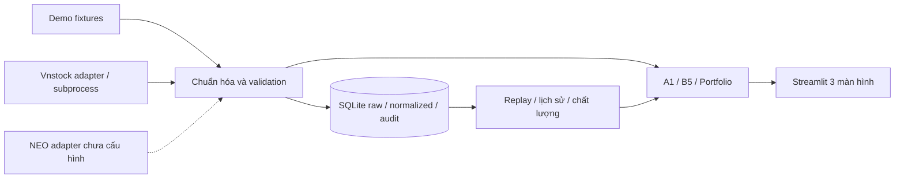

# NEO LiquidityLab

Hệ thống mô phỏng chi phí thực hiện lệnh và stress thanh khoản danh mục cổ phiếu Việt Nam, phục vụ đồ án UEL 2026–2027. Nhà đầu tư có thể xem quy mô lệnh so với ba mức chào mua/bán và số tiền ước tính **chỉ trên phần được bao phủ**. Dành cho người có vị thế tương đối lớn so với độ sâu quan sát.

MVP gồm A1 (quét sổ lệnh), B5 (stress giả định), danh mục nhập tay, SQLite, collector và replay. **Demo là dữ liệu synthetic; NEO chưa tích hợp. Sản phẩm hiện chưa đủ tiêu chí NEO API cốt lõi để nộp cuối kỳ.** Không có chức năng đặt/sửa/hủy lệnh thật.

**GitHub Actions đã triển khai nhưng lịch thu đang tắt** tại repo `TranThanhPhu39/neo-liquiditylab`: [quy trình vận hành](docs/github_actions.md). Kiểm thử Ubuntu và khôi phục checkpoint synthetic mã hóa trên runner mới đã đạt. Sau khi giải phóng thiết bị Vnstock, một runner đăng nhập thành công nhưng runner mới tiếp theo lại bị `VNSTOCK_AUTH_DEVICE_LIMIT`; nguồn hiện tại chưa chạy tự động nhiều ngày được. `LIQUIDITYLAB_WORKER_ENABLED=false`, task Windows cũng đang tạm dừng. Source public không chứa `.env`, database thu thật hoặc SDK authentication state. Đang kiểm tra [DNSE thay thế](docs/dnse_integration.md), chưa gọi DNSE thực vì thiếu API Secret.

**Bộ thu toàn thị trường đã kiểm tra, task Windows đang Disabled:** [hướng dẫn vận hành](docs/whole_market_automation.md). Cấu hình lịch Windows là 09:10 thứ Hai–thứ Sáu, có bắt kịp khi đăng nhập; thu các cửa sổ 09:15–11:30 và 13:00–14:30. Danh mục làm mới mỗi ngày; lượt thử đã lấy đủ 1.520 cổ phiếu HOSE/HNX/UPCOM theo nhóm. Toàn thị trường lưu raw; A1/B5 tự động chuẩn hóa hiện giới hạn FPT/HPG/ACB đã thẩm định. Cờ STOP_VNSTOCK/NEO_READY hoặc `enabled=false` dừng thu, lịch không có ngày kết thúc cố định.

Đã chuẩn bị [phương án server miễn phí và bộ systemd Linux](docs/free_server_deployment.md). Chưa có VM; phương án GitHub đã có workflow nhưng chưa đủ điều kiện bật thu định kỳ vì giới hạn thiết bị Vnstock. Hiện không có lịch thu tự động nào đang hoạt động.

Cập nhật 28/10: đã thu và chuẩn hóa **66 snapshot thật / 22 batch / 3 mã**, từ 13:23 đến 14:28, collector dừng 14:30. [Thẩm định đơn vị](report/kbs_unit_review_2026-10-28.md) kết luận SDK 5.2.1/KBS đã trả VND và CP, hệ số 1/1, dựa trên chú thích bảng KBS và 8 cặp đối chiếu chính xác; thời điểm ảnh chỉ xấp xỉ, không chứng nhận đồng bộ quote. [Kiểm chứng A1/B5](report/normalized_validation_2026-10-28.json) đã chạy trên 66 snapshot chuẩn hóa. Mở ứng dụng, chọn **vnstock → Replay lịch sử** để phân tích offline; không cần bật collector. Timestamp nguồn vẫn thiếu, dữ liệu chỉ thuộc một phần cửa sổ chiều.

Xem [báo cáo có biểu đồ](report/analysis_2026-10-28.html) hoặc [bản Markdown](report/analysis_2026-10-28.md). Tái tạo offline bằng `python -m scripts.report_normalized`; CSV chuẩn hóa ở `data/processed/normalized_2026-10-28.csv`. [Kiểm tra migration](report/normalization_verification_2026-10-28.json) xác nhận checksum raw không đổi, 66 dòng lineage và chạy lại không sinh trùng.

## Chạy trên Windows / PowerShell

Yêu cầu Python >=3.11; đã chạy kiểm thử trên Python 3.12.10. Tại thư mục chứa README:

```powershell
py -m venv .venv
.\.venv\Scripts\python.exe -m pip install -r requirements.txt
.\.venv\Scripts\python.exe -m scripts.check_environment
.\.venv\Scripts\python.exe -m streamlit run src/app/main.py --server.address 127.0.0.1
```

Mở http://localhost:8501. Mặc định `DATA_SOURCE=demo`, không cần token hay mạng khi chạy. Không cần kích hoạt môi trường hay đổi ExecutionPolicy. Môi trường `.venv` đã được tạo trong lần triển khai này. Nếu Python Microsoft Store báo Access denied trong sandbox, chạy các lệnh từ PowerShell bình thường; không cần thay đổi chính sách hệ thống.

`requirements-lock.txt` chốt toàn bộ phiên bản đã kiểm thử, bao gồm SDK Vnstock tùy chọn. Để tái lập đúng môi trường đó: cài bằng `python -m pip install --extra-index-url https://vnstocks.com/api/packages -r requirements-lock.txt`, rồi `python -m pip install -e . --no-deps`. Cài theo `requirements.txt` là đủ cho MVP offline và không bắt buộc SDK.

Ba màn hình: **Thanh khoản**, **Mô phỏng thực hiện lệnh**, **Stress danh mục**. HPG demo dùng đúng ví dụ 30.000/29.950/29.900 VND với 1.000/1.500/1.000 CP. Cảnh báo snapshot cũ là chủ ý: fixture cố định ngày 20/10/2026. Quyền cho phép phân tích dữ liệu cũ được hiển thị rõ. Không dùng giá fixture như giá hiện tại.

## Thu thập, kiểm tra, xuất và replay

Đã có collector **raw thật** cho giai đoạn chưa xác minh đơn vị: xem [runbook thu thập](docs/collection_runbook.md). Raw được lưu riêng, có quota/rate gate, báo cáo tiến độ, CSV và backup; dashboard có raw replay. Chế độ này không đưa dữ liệu chưa xác minh vào A1/B5. Bộ lệnh bên dưới thao tác kho snapshot chuẩn hóa.

Đã triển khai [migration và chốt sau phiên](docs/raw_normalization.md): hồ sơ đơn vị có bằng chứng/checksum, lineage raw → snapshot, chống trùng và rollback; giữ chặn khi chưa có bằng chứng thật. Có price-only diagnostics và tác vụ chốt audit/CSV/backup sau 14:30 cho lượt thu ngày 28/10.

```powershell
.\.venv\Scripts\python.exe -m scripts.collect_once --source demo
.\.venv\Scripts\python.exe -m scripts.validate_database --source demo --output report/demo_quality.json
.\.venv\Scripts\python.exe -m scripts.export_data --source demo --symbol HPG --output data/processed/hpg.csv
.\.venv\Scripts\python.exe -m scripts.export_data --source demo --start '2026-10-20T00:00:00+07:00' --end '2026-10-20T23:59:59+07:00' --output data/processed/demo.parquet
```

Dashboard có nút lưu fixture demo, bộ lọc ngày, tải CSV và JSON chất lượng. Chọn **Replay lịch sử** để đọc snapshot đã lưu; không gọi mạng. Khi replay, thời gian phân tích là thời điểm nhận đã chọn, không phải đồng hồ hiện tại. Không nội suy lịch sử hay dùng thông điệp chưa đến.

Chạy demo collector định kỳ không sinh dữ liệu mới: fixture giữ nguyên thời điểm và được dedup. Database có thể xem bằng trình SQLite hoặc các CLI trên. Bảng raw chỉ lưu trường thị trường theo allowlist; tách khỏi bản chuẩn hóa.

## Vnstock (tùy chọn)

Đọc [tài liệu cài đặt](https://vnstocks.com/docs/vnstock/cai-dat), [Market](https://vnstocks.com/docs/vnstock/thi-truong-market) và [quyền/hạn mức](https://vnstocks.com/docs/vnstock/tham-khao/cap-quyen-va-gioi-han) trước khi bật. Adapter gọi `Market().quote(symbols, source="kbs")`; không gọi `order_book()` cần quyền Mở rộng. Giá quote dùng VND, khác OHLCV nghìn đồng. Phải xác nhận khối lượng là cổ phiếu trong môi trường tài khoản thực trước khi bật, không tự nhân/chia giá hay khối lượng.

Phiên bản SDK thực tế và các hạn chế được ghi trong [xác minh nguồn](docs/source_verification.md). Đã kiểm thử quote thật và migration trên dữ liệu thực thu; chưa kiểm thử NEO. Chỉ cài bản được nhà cung cấp hỗ trợ và đã đối chiếu adapter.

```powershell
.\.venv\Scripts\python.exe -m pip install -r requirements-collector.txt
Copy-Item .env.example .env
# Chỉnh .env sau khi xác minh quyền, quota và đơn vị:
# DATA_SOURCE=vnstock
# VNSTOCK_ACCESS_CONFIRMED=true
# VNSTOCK_PRICE_UNIT=VND
# VNSTOCK_VOLUME_UNIT=shares
# VNSTOCK_API_KEY=<chỉ lưu cục bộ nếu tài khoản yêu cầu>
.\.venv\Scripts\python.exe -m scripts.check_environment --source vnstock
.\.venv\Scripts\python.exe -m scripts.collect_once --source vnstock --symbols FPT HPG ACB
.\.venv\Scripts\python.exe -m scripts.collect_market --source vnstock --duration 7200 --interval 180
```

Không ghi token vào lệnh shell/history, repo, screenshot hoặc báo cáo. Đăng nhập SDK có thể lưu khóa trong kho cục bộ của Vnstock theo cơ chế nhà phát hành. Không commit thư mục đó. SDK chạy trong subprocess, timeout mặc định 30 giây; tối đa 2 retry **chỉ với timeout**, exponential backoff với sàn 180 giây cho Vnstock. Không retry lỗi quyền, schema, hạn mức. `.env` mặc định không bật quyền và chưa xác nhận đơn vị volume. Request thất bại không chuyển sang demo.

Khóa có thể lưu trong `.env` dưới tên chuẩn `VNSTOCK_API_KEY` hoặc tên thay thế `vnstock_api`. Khi cả hai có giá trị, tên chuẩn được ưu tiên. Không cần đổi hoặc gửi lại khóa vào chat. Kiểm tra đăng nhập bằng `.\.venv\Scripts\python.exe -m scripts.probe_vnstock`; lệnh này chỉ in trạng thái tài khoản và quota đã lọc thông tin nhạy cảm, không gọi bảng giá. Thêm `--quote` để thực hiện một lần chẩn đoán bảng giá, tách khỏi collector và kho phân tích. Collector tự động yêu cầu đăng nhập; không dùng cấp Khách cho vòng lặp.

Collector chạy trong cửa sổ bảo thủ 09:15–11:30 và 13:00–14:30 giờ Việt Nam ngày thường; đây **không phải lịch sàn đã xác minh**, không phân biệt đầy đủ HOSE/HNX/UPCOM. Cung cấp ngày nghỉ qua `--holidays YYYY-MM-DD ...`. Không tự chạy vào ATO/ATC; `--include-outside-session` là lựa chọn thủ công, không làm dữ liệu thành realtime. Dừng bằng Ctrl+C. Tiến trình không tự khởi động khi mở máy và không tự bật thu một tháng.

Khởi đầu 3 mã; thêm 10–15 mã trong `config/symbols.yaml` khi quyền/hạn mức cho phép. Theo dõi báo cáo chất lượng mỗi ngày. Nghỉ tối thiểu 180 giây trong provider và database dùng chung, kể cả bấm lại dashboard; nhịp này **không bảo đảm** đủ quota ngày/tháng. Không chạy nhiều database/collector cho cùng tài khoản để tăng hạn mức. Mục tiêu 5–10 phiên thật trở lên, tốt hơn một tháng thực thu; báo cáo không tự tạo phiên thiếu.

## Kiểm thử

```powershell
.\.venv\Scripts\python.exe -m pytest -q --basetemp=.pytest_tmp
```

Tests chạy offline, không gọi SDK mạng. Bao gồm ví dụ bắt buộc (gross 89.875.000, cost 125.000 VND), invariant, stress/reverse stress, CSV, stale/skew, dedup, khóa SQLite và ba màn hình qua Streamlit AppTest. Kết quả thực tế lưu ở [báo cáo kiểm thử](report/test_results.md).

## Kiến trúc



`src/finance` chỉ nhận schema nội bộ, không import Vnstock. `config/` quản lý môi trường, mã và kịch bản tham khảo. Giá trị tiền dùng Decimal; chỉ chuyển float để vẽ. Có thể xuất Parquet khi cài pyarrow (đã có cùng Streamlit trong môi trường kiểm thử).

Tài liệu: [kiến trúc](docs/architecture.md), [dictionary](docs/data_dictionary.md), [phương pháp](docs/financial_methodology.md), [chất lượng](docs/data_quality.md), [giới hạn](docs/limitations.md), [NEO](docs/neo_integration_plan.md), [đối chiếu đề](docs/assignment_compliance.md), [dàn ý báo cáo](report/report_outline.md).
